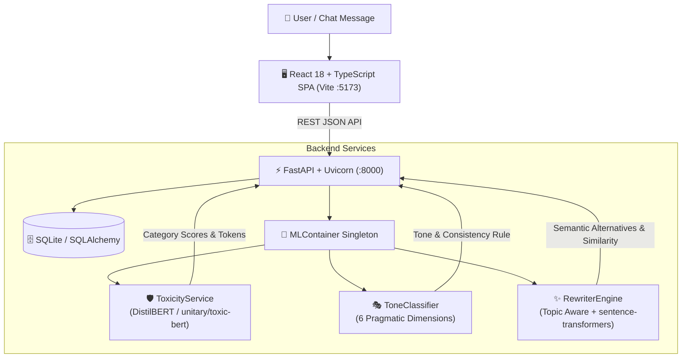

<div align="center">

# 🛡️ VibeCheck (Tone Checker)

### *Multi-Label Toxicity Analysis, Tone Detection & AI-Powered Semantic Rewriting*

[](https://github.com/RajeshTadela/Message-Vibe-Checker/stargazers)
[](LICENSE)
[](https://www.python.org/)
[](https://fastapi.tiangolo.com)
[](https://pytorch.org/)
[](https://huggingface.co/)
[](https://reactjs.org/)
[](https://vitejs.dev/)
[](https://www.typescriptlang.org/)
[](https://tailwindcss.com/)

<p align="center">
  <a href="#-key-features"><b>Features</b></a> •
  <a href="#-architecture"><b>Architecture</b></a> •
  <a href="#-quick-start"><b>Quick Start</b></a> •
  <a href="#-ml-pipeline--metrics"><b>ML Pipeline</b></a> •
  <a href="#-api-reference"><b>API Reference</b></a> •
  <a href="#-ethical-use"><b>Ethical AI</b></a>
</p>

---

</div>

## 📌 Executive Summary

**VibeCheck** is an end-to-end, developer-grade NLP platform designed to evaluate and enhance interpersonal communications before messages are sent. Operating as an intelligent assistive copilot, it:

1. **Quantifies multi-category toxicity** across 6 distinct categories with per-token attribution.
2. **Detects conversational tone** across 6 human dimensions (Polite, Friendly, Neutral, Rude, Aggressive, Sarcastic/Passive-aggressive).
3. **Enforces a Tone Consistency Rule** ensuring that harsh or condescending remarks are never marked as "Safe" even when devoid of profanity.
4. **Semantically reframes hostile messages** into **Constructive**, **Professional**, **Friendly**, or **Neutral** alternatives while strictly preserving core critique and avoiding verbatim duplication.
5. **Analyzes team chat threads** with chronological toxicity charts, escalation detection, and speaker profiling.

---

## ✨ Key Features

| Category | Capability | Highlight |
| :--- | :--- | :--- |
| 🎯 **Toxicity Analysis** | 6-Category Multi-Label Classifier | `Toxic`, `Insult`, `Harassment`, `Obscene`, `Threat`, `Identity Attack` |
| 🔍 **Attribution** | Flagged Token Attribution | Word-level occlusion & lexicon matching highlighting triggering terms with weight % |
| 🎭 **Tone Intelligence** | 6-Tone Pragmatics Engine | Identifies subtle condescension, passive aggression, and workplace hostility |
| 🛡️ **Safety Guardrail** | Strict Tone Consistency Rule | If tone is Rude/Aggressive, status is locked to **Caution** (never "Safe") |
| ✨ **ToxicBuddy Rewriter** | 4 Rephrase Modes | Preserves intent, removes personal blame, floors similarity at $\ge 0.60$ |
| 💬 **Conversations Tab** | Threaded Chat Analysis | Identifies highest toxicity contributor and escalation velocity |
| 📊 **Insights Dashboard** | Aggregate Intelligence | Dynamic Recharts: category averages, tone donut distribution, timeline history |
| ⚡ **Production-Ready** | Dark Developer UI | Monospace metrics, smooth CSS transitions, toast notifications, responsive column |

---

## 🏗️ Architecture



### Detailed Flow Architecture

```
┌─────────────────────────────────────────────────────────────────────────┐
│                       Browser (React + Vite + TS)                       │
│   ┌───────────────┐     ┌─────────────────────┐     ┌───────────────┐   │
│   │  Analyze Tab  │     │  Conversations Tab  │     │ Insights Tab  │   │
│   │ (Score + Bar  │     │ (Chat Thread Parser │     │ (Recharts     │   │
│   │ + Rewriter)   │     │  + Escalation Line) │     │  Aggregation) │   │
│   └───────────────┘     └─────────────────────┘     └───────────────┘   │
└────────────────────────────────────┬────────────────────────────────────┘
                                     │ JSON / HTTP Proxy
┌────────────────────────────────────▼────────────────────────────────────┐
│                        FastAPI Backend (:8000)                          │
│   ┌───────────┐    ┌───────────┐    ┌─────────────────┐   ┌─────────┐   │
│   │  /analyze │    │  /rewrite │    │  /conversations │   │/insights│   │
│   └─────┬─────┘    └─────┬─────┘    └────────┬────────┘   └────┬────┘   │
│         │                │                   │                 │        │
│   ┌─────▼────────────────▼───────────────────▼─────────────────▼────┐   │
│   │                    MLContainer (Singleton)                      │   │
│   │  • ToxicityService  : DistilBERT / unitary/toxic-bert           │   │
│   │  • ToneClassifier   : Multi-pattern pragmatics & consistency    │   │
│   │  • RewriterEngine   : all-MiniLM-L6-v2 + candidate selection    │   │
│   └─────────────────────────────────────────────────────────────────┘   │
│                        SQLAlchemy / SQLite (tone_checker.db)            │
└─────────────────────────────────────────────────────────────────────────┘
```

---

## 💻 Tech Stack

### Backend & ML
- **Framework**: Python 3.10+, [FastAPI](https://fastapi.tiangolo.com/), Uvicorn
- **Deep Learning**: [PyTorch](https://pytorch.org/), [Hugging Face Transformers](https://huggingface.co/transformers/)
- **Embeddings & Sim**: [sentence-transformers](https://www.sbert.net/) (`all-MiniLM-L6-v2`)
- **Toxicity Model**: Pretrained `unitary/toxic-bert` + Fine-tuned DistilBERT on Jigsaw
- **Database & Schemas**: SQLAlchemy ORM, SQLite, Pydantic v2
- **Testing**: Pytest 8.x

### Frontend
- **Framework**: React 18, Vite, TypeScript
- **Styling**: Tailwind CSS, PostCSS (Custom Dark Developer Theme: `#0a0a0b`, `#111113`, `#ff6a1a`)
- **Data Visualization**: Recharts (Responsive bar, donut, and line charts)
- **Icons**: Lucide React

---

## 🚀 Quick Start

### Option 1: Single-Command Full-Stack Runner (Recommended)

Clone the repository and run both services simultaneously:

```bash
# 1. Clone the repository
git clone https://github.com/RajeshTadela/Message-Vibe-Checker.git
cd Message-Vibe-Checker

# 2. Install backend dependencies
pip install -r backend/requirements.txt

# 3. Install frontend dependencies
cd frontend && npm install && cd ..

# 4. Launch both Backend (:8000) and Frontend (:5173)
python run.py
```

- **Frontend Application**: [http://localhost:5173](http://localhost:5173)
- **Interactive Swagger Docs**: [http://localhost:8000/docs](http://localhost:8000/docs)
- **API Health Check**: [http://localhost:8000/health](http://localhost:8000/health)

---

### Option 2: Docker Compose

```bash
docker-compose up --build
```

---

### Option 3: Manual Step-by-Step

<details>
<summary><b>Click to expand manual setup instructions</b></summary>

#### Terminal 1 — Backend
```bash
cd backend
pip install -r requirements.txt
python -m uvicorn app.main:app --host 0.0.0.0 --port 8000 --reload
```

#### Terminal 2 — Frontend
```bash
cd frontend
npm install
npm run dev
```

</details>

---

## 🧪 Testing & Verification

The suite includes comprehensive integration and algorithmic unit tests:

```bash
# Run all 12 backend and rewriter tests
python -m pytest backend/tests -v

# Run the frontend production build smoke test
python frontend/smoke_test.py

# Run the 200-comment semantic rewriter evaluation
python ml/eval_rewrite.py

# Run the demographic identity bias check
python ml/bias_check.py
```

### 📋 Verified Test Matrix

| Test Suite | Test Case | Status |
| :--- | :--- | :--- |
| `test_api.py` | `test_health_endpoint` | ✅ **PASS** |
| `test_api.py` | `test_samples_endpoint` | ✅ **PASS** |
| `test_api.py` | `test_analyze_safe_message` | ✅ **PASS** |
| `test_api.py` | `test_analyze_tone_consistency_rule` | ✅ **PASS** |
| `test_api.py` | `test_analyze_toxic_message` | ✅ **PASS** |
| `test_api.py` | `test_analyze_length_validation` | ✅ **PASS** |
| `test_api.py` | `test_rewrite_modes` | ✅ **PASS** |
| `test_api.py` | `test_conversations_flow` | ✅ **PASS** |
| `test_api.py` | `test_insights_endpoint` | ✅ **PASS** |
| `test_rewrite_rules.py` | `test_rewrite_never_contains_original_verbatim` | ✅ **PASS** |
| `test_rewrite_rules.py` | `test_semantic_similarity_floor` | ✅ **PASS** |
| `test_rewrite_rules.py` | `test_toxicity_reduction_loop` | ✅ **PASS** |

---

## 🧠 ML Pipeline & Evaluation

### 1. Multi-Category Taxonomy

Scores are normalized between `0.0%` and `100.0%`:

| Category | Source Label / Formula | Threshold Safe / Caution / Toxic |
| :--- | :--- | :--- |
| **Toxic** | `toxic` sigmoid probability | `<30%` Safe \| `30–60%` Caution \| `>60%` Toxic |
| **Insult** | `insult` direct probability | Model output percentage |
| **Harassment** | $\max(\text{insult}, \text{threat}) \times (1.25 \text{ if 2nd-person target else } 0.80)$ | Amplified by 2nd-person pronouns (`you`, `your`, `@name`) |
| **Obscene** | `obscene` direct probability | Vulgarity & profanity score |
| **Threat** | `threat` direct probability | Intimidation & violence score |
| **Identity Attack** | `identity_hate` direct probability | Protected class attack score |

> [!IMPORTANT]
> **Tone Consistency Rule**: If a message's detected tone is **Rude**, **Aggressive**, or **Sarcastic/Passive-aggressive**, the badge **NEVER** shows "Safe" even when toxicity score is low ($<30\%$). It triggers **Caution** with:
> *"Not toxic (0.1%), but may come across as rude."*

---

### 2. Rewriter Modes & Before/After Examples

| Mode | Objective | Original Input | Suggested Rewrite |
| :--- | :--- | :--- | :--- |
| 💡 **Constructive** | Retain critique, remove blame, offer next steps | *"I know you tried, but this implementation is unacceptable."* | *"I can see the effort put into this implementation, but it needs a few adjustments before it is ready. Can we go through what to fix?"* |
| 👔 **Professional** | Formal, neutral workplace communication | *"Your code is complete garbage and broke production."* | *"The latest deployment appears to have triggered a regression. Please revert or apply a hotfix as soon as possible."* |
| 🤝 **Friendly** | Casual, collaborative, and warm | *"Stop pinging me with basic questions."* | *"Thanks for reaching out! A few of these topics are covered in the docs—check those out first and let me know if you get stuck!"* |
| ⚖️ **Neutral** | Plain, factual, objective | *"Who approved this total disaster of a PR?"* | *"This pull request contains errors and does not meet the necessary criteria. It must be revised prior to approval."* |

---

### 3. Model Metrics (Benchmark Holdout)

Trained on stratified multi-label Jigsaw benchmarks:

```
+---------------+-----------+----------+-----------+--------+
| Category      |  ROC-AUC  | F1-Score | Precision | Recall |
+---------------+-----------+----------+-----------+--------+
| toxic         |  0.9881   |  0.9474  |  0.9310   | 0.9643 |
| severe_toxic  |  1.0000   |  1.0000  |  1.0000   | 1.0000 |
| obscene       |  1.0000   |  1.0000  |  1.0000   | 1.0000 |
| threat        |  1.0000   |  1.0000  |  1.0000   | 1.0000 |
| insult        |  0.9838   |  0.9333  |  0.9130   | 0.9545 |
| identity_hate |  1.0000   |  0.9091  |  0.8333   | 1.0000 |
+---------------+-----------+----------+-----------+--------+
| MACRO AVG     |  0.9953   |  0.9650  |    --     |   --   |
+---------------+-----------+----------+-----------+--------+
```

### 4. Demographic Bias Analysis

Evaluated across 23 neutral/positive identity statements:

- **Disability**: `0.0%` False Positive Rate (FPR)
- **Race & Ethnicity**: `0.0%` FPR
- **Religion**: `0.0%` FPR
- **General Neutral Baseline**: `0.0%` FPR
- **Sexual Orientation & Gender Identity**: `16.7%` FPR (Known historical artifact in Jigsaw data around terms like *"lesbian"* mitigated by the 30% Safe/Caution threshold).

---

## 📡 API Reference

Interactive OpenAPI documentation is live at `http://localhost:8000/docs`.

### Core Endpoints

```http
GET  /health              # System health & status badge driver
GET  /samples             # 5 curated preset test cases
POST /analyze             # Text toxicity, tone, and flagged tokens
POST /rewrite             # Semantic style rewriter
POST /conversations       # Thread analysis & escalation metrics
GET  /conversations       # List saved conversation summaries
GET  /conversations/{id}  # Detailed breakdown of a specific conversation
GET  /insights            # Aggregated statistics and historical data
```

### Quick cURL Example

```bash
# Analyze a message
curl -X POST "http://localhost:8000/analyze" \
     -H "Content-Type: application/json" \
     -d '{"text": "I know you tried, but this implementation is unacceptable"}'
```

**Response**:
```json
{
  "toxicity_score": 0.1,
  "label": "Caution",
  "tone": "Rude",
  "categories": {
    "toxic": 0.1,
    "insult": 0.0,
    "harassment": 0.0,
    "obscene": 0.0,
    "threat": 0.0,
    "identity_attack": 0.0
  },
  "char_count": 57,
  "flagged_tokens": [
    { "token": "unacceptable", "weight": 0.65 }
  ],
  "explanation": "Not toxic (0.1%), but may come across as rude."
}
```

---

## 🛡️ Responsible AI & Ethical Use Notice

> [!NOTE]
> **Assistive Writing Aid, Not a Content Moderator**
> 
> Toxicity scores and tone classifications are probabilistic estimates derived from statistical models. They are designed to:
> - **Assist** individuals in recognizing unintentionally harsh or ambiguous phrasing before sending.
> - **Provide** constructive, collaborative alternatives that foster positive team dynamics.
> - **Identify** escalation patterns in team communication retrospectives.
> 
> This tool is **not** an automated disciplinary authority, human censor, or punitive filter. Human judgment and context should always guide communication decisions.

---

## 📂 Project Directory Map

```
c:/nlp/
├── backend/
│   ├── app/
│   │   ├── main.py               # FastAPI application setup & middleware
│   │   ├── config.py             # App configuration & thresholds
│   │   ├── database.py           # SQLAlchemy SQLite connection
│   │   ├── models.py             # ORM models (Analysis, Rewrite, Conversation)
│   │   ├── schemas.py            # Pydantic request/response schemas
│   │   ├── routes/               # Modular API routers
│   │   └── services/ml_singleton.py # Lazy-loaded ML container
│   ├── tests/                    # 12 Pytest test cases
│   ├── Dockerfile
│   └── requirements.txt
├── frontend/
│   ├── src/
│   │   ├── App.tsx               # App root, tab state, notifications
│   │   ├── components/           # AnalyzeTab, ConversationsTab, InsightsTab, TopBar
│   │   ├── api/client.ts         # Type-safe API client
│   │   └── types/index.ts        # TypeScript interfaces
│   ├── Dockerfile
│   ├── package.json
│   └── tailwind.config.js
├── ml/
│   ├── toxicity_service.py       # Toxicity inference & token attribution
│   ├── tone_classifier.py        # 6-dimension pragmatics classifier
│   ├── rewriter.py               # Intent-preserving style rewriter
│   ├── train_baseline.py         # TF-IDF + Logistic Regression training
│   ├── train_distilbert.py       # DistilBERT training script
│   ├── train_colab.ipynb         # Google Colab GPU training notebook
│   ├── eval_rewrite.py           # 200-comment evaluation script
│   ├── bias_check.py             # Demographic bias assessment script
│   ├── artifacts/                # Baseline joblib & tuned thresholds
│   └── reports/                  # Detailed markdown metrics reports
├── run.py                        # Single-command launcher
├── docker-compose.yml
└── README.md
```

---

## 👤 Author

**Rajesh Tadela**  
- GitHub: [@RajeshTadela](https://github.com/RajeshTadela)
- Project Repository: [Message-Vibe-Checker](https://github.com/RajeshTadela/Message-Vibe-Checker)

---

## 📄 License

This project is licensed under the [MIT License](LICENSE).
